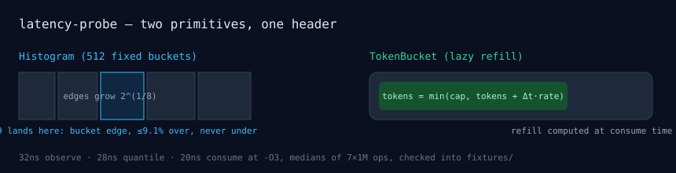

# latency-probe

Two primitives for watching and shaping a serving path, as one header-only
C++17 library: an exponential-bucket latency histogram (p50/p99/p999 in
constant memory) and a token-bucket rate limiter (burst-aware, lazy refill,
no timer thread). No dependencies beyond the standard library.




## Verify in 60 seconds

```bash
git clone https://github.com/mrodgersjs-web/latency-probe.git
cd latency-probe
cmake -B build -G Ninja -DCMAKE_BUILD_TYPE=Release && cmake --build build
./build/probe_tests   # the smoke: self-checking, exit 0 = pass
./build/probe_bench   # prints the BENCH line the fixture records
```

## Why it exists

`fixtures/bench-baseline.json` holds the performance claim: 32ns per
observe, 28ns per quantile query, 20ns per consume at `-O3` (medians of
7 repetitions of 1M ops). CI builds Release on gcc and clang, Linux and
macOS, plus a Debug run under AddressSanitizer and UndefinedBehaviorSanitizer.
Because the table is fixed at 512 buckets, those numbers do not degrade with
traffic volume — the property that makes log-bucketing the right trade for
anything measuring at serving rates.

## The two contracts, stated precisely

- **Quantiles are upper bounds.** A reported p99 is the edge of the bucket
  containing the true value: at most `2^(1/8) − 1` ≈ 9.1% over, never under.
  For alerting that direction of error is the useful one. A Gaussian
  cross-check in the tests (`σ=100us, n=50k`) holds the estimate inside
  `[0.95x, 1.25x]` of sorted truth at p50/p90/p99/p999.
- **Burst is capped by capacity, refill is exact to the clock delta.**
  Long idle periods clamp at capacity; `seconds_until()` names the wait
  before a request of size n fits.

## Design notes

The header itself carries the interview-grade commentary: why log-bucketing
beats sorted storage at volume, why lazy refill beats a timer thread, and
why thread-compatibility (caller owns the mutex) beats lock-free at
thousands-per-second. See the block comments in `include/latency/probe.hpp`.

Part of the [mrodgersjs-web](https://github.com/mrodgersjs-web) FDE studio fleet — control planes, gates, fleets, proof. [rodgersintelligence.com](https://rodgersintelligence.com)
